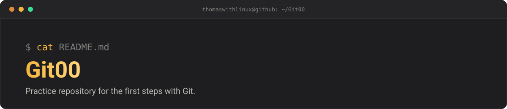

<p align="center">
  
</p>

# Git00 — *first steps with Git*


Practice repository used to learn the basics of Git: creating a repository,
making commits and pushing them to GitHub. It contains a single static page.

## Table of contents

- [Overview](#overview)
- [Usage](#usage)
- [Project structure](#project-structure)
- [License](#license)
- [Author](#author)

## Overview

A minimal HTML page (`index.html`) displaying "Hello World", used as the
subject of the first commits.

## Usage

```bash
git clone https://github.com/thomaswithlinux/Git00.git
cd Git00
```

Then open `index.html` in your browser.

## Project structure

```
Git00/
├── docs/
│   └── banner.svg      # README banner
├── index.html          # the "Hello World" page
├── LICENSE             # MIT license
└── README.md           # this file
```

## License

Released under the **MIT** license — see the [LICENSE](LICENSE) file.

## Author

**Thomas Letard** — [@thomaswithlinux](https://github.com/thomaswithlinux) ·
[Portfolio](https://thomaswithlinux.github.io/)
